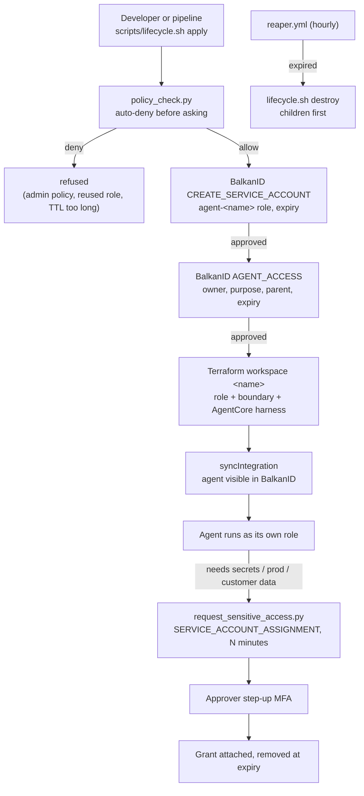

# Architecture: guardrails for developer-created Bedrock agents

## Problem

Developers can stand up an AWS Bedrock AgentCore agent in minutes. The fastest way to give it access is to reuse what is at hand: the developer's own role, a CI role, or a broad managed policy. The agent then holds developer-level privilege with no named owner, no approval and no end date. If it is compromised or misprompted, everything the developer can touch is in reach.

## Design

1. **Own identity, never the creator's.** Every agent gets a dedicated execution role under `/balkanid-agents/`, approved in BalkanID (`CREATE_SERVICE_ACCOUNT`). Reusing an existing role is refused.
2. **Approved before it exists.** `AGENT_ACCESS` names the human owner, the requesting developer, purpose, parent, policies and expiry. Nothing is provisioned until it is approved.
3. **Least privilege, more only on request.** The role can call its model and write logs. Anything else is a reviewed policy. Secrets, production and customer data are minutes-long grants with step-up MFA.
4. **A ceiling that cannot be raised from inside.** A permissions boundary denies identity, organization and role-hopping actions and data destruction, whatever policies are later attached.
5. **Subagents inherit the ceiling, not more.** A child agent has its own role but shares its parent's boundary, and is reaped with its parent.
6. **Ephemeral.** Every agent has an approved expiry. A scheduled reaper destroys it, children first.

## Layers of control

| Layer | Where | What it stops |
|---|---|---|
| Pre-check | `policies/guardrails.json`, `policy_check.py` | Broad managed policies, reused developer/admin/human roles, the caller's own role, excessive TTLs, bad names, oversize grants. Runs before any API call. |
| BalkanID policy engine | Request policies ([BALKANID_POLICIES.md](../policies/BALKANID_POLICIES.md)) | The same rules for requests raised any other way; routing of sensitive grants to the right approver; auto-approval of low-risk requests. |
| Approval | `AGENT_ACCESS`, `CREATE_SERVICE_ACCOUNT` | Agents without a named owner, purpose and expiry. Fails closed on deny or timeout. |
| Step-up | Sensitive insight on grant policies | Approving access to secrets, production or customer data without a fresh MFA check. |
| IAM | Execution role, permissions boundary | Anything outside the approved policies and the boundary, even if a pipeline is misconfigured or a grant is too broad. |
| Time | Expiry tag, reaper, grant duration | Agents and grants that outlive their purpose. |

## Control flows

### Creating an agent

`scripts/lifecycle.sh apply <name>`:

1. `policy_check.py` evaluates the request locally and fixes the expiry (`AGENT_EXPIRES_AT`).
2. `service_account_gate.py` asks BalkanID to approve `agent-<name>` with the requested policies and that expiry.
3. `gate.py` asks BalkanID to approve the agent with owner, requester, purpose, parent and `inherits_creator_permissions: false`.
4. Terraform (one workspace per agent) creates the boundary (or looks up the parent's), the role, its policies and the AgentCore harness, tagging the role with owner and expiry.
5. `trigger_sync.py` has BalkanID discover the agent and role, so they appear with their owner in inventory and reviews.

### Sensitive access

`scripts/lifecycle.sh grant <name> BalkanIDAgentSecretsRead 30 "<reason>"`:

1. `policy_check.py --grant` confirms the grant exists and is within its maximum length.
2. The agent's BalkanID service account id is resolved, and `SERVICE_ACCOUNT_ASSIGNMENT` is raised for that policy with `duration` set.
3. The approver completes step-up MFA (because the policy is marked sensitive) and approves. BalkanID attaches the policy; it is removed when the duration ends.
4. If BalkanID requires step-up from the requester, the request returns `stepUpRequired` and the script stops and says so.

### Teardown

The reaper lists roles under `/balkanid-agents/`, reads `balkanid-expires-at`, and destroys every expired agent, every child of an expired parent, and any agent role missing an expiry tag. Children go first so a parent's boundary is never removed from under them. A final sync updates BalkanID.

## Threat model

| Threat | Mitigation |
|---|---|
| Agent runs with its creator's permissions | Reuse of any existing role is refused; the agent's role trusts only `bedrock-agentcore.amazonaws.com` in this account. |
| Broad policy attached "just to get it working" | Pre-check and BalkanID auto-deny; the boundary caps services regardless. |
| Agent escalates (creates users, attaches policies, assumes other roles) | Boundary denies `iam:*`, `sts:AssumeRole`, Organizations and SSO. |
| Agent destroys data | Boundary denies bucket, table and key deletion and log group deletion. |
| Long-lived forgotten agents | Required expiry, hourly reaper, reviews in BalkanID. |
| Subagent sprawl | Children share the parent's boundary and die with the parent. |
| Sensitive data access without oversight | Minutes-long grants, named approver, step-up MFA, audit in BalkanID. |

**Limits.** Within its approved policies the agent can do what those policies allow; the boundary is the ceiling, not a content filter. Runtime inspection of individual tool calls (prompt and action level) is a separate layer, for example an MCP or AI gateway in front of the agent's tools.

## Production considerations

- Use a remote Terraform backend; the reaper must see the same state as the lifecycle workflow.
- Prefer `request.actioned` webhooks over long polling for approvals that take hours.
- Tighten `allowed_services` per team, and keep grant policies scoped to named resources.
- Protect the `agent-lifecycle` GitHub environment with required reviewers if it uses production credentials.
